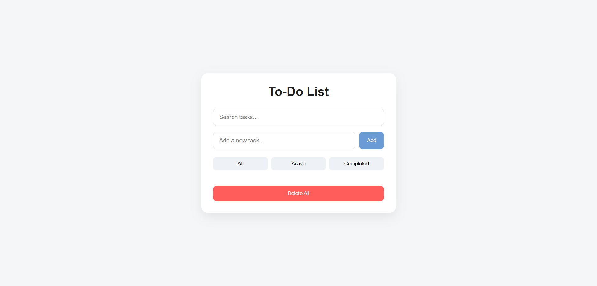

# 📝 Todo List

A simple, modern, and responsive Todo List application built using HTML, CSS, and JavaScript. This application allows users to manage their daily tasks by adding, completing, and deleting tasks through an interactive and user-friendly interface.

---

## 🌟 Live Demo

👉 View Live Demo: [https://roghayem.github.io/to-do-list/](https://roghayem.github.io/to-do-list/)

---

## 🖼️ Preview



---

## ✨ Features

- Add new tasks
- Mark tasks as completed
- Delete tasks
- Manage daily tasks through a simple interface
- Interactive functionality using JavaScript
- Responsive design for different screen sizes
- Clean and user-friendly interface

---

## 🛠️ Built With

- HTML5
- CSS3
- JavaScript (ES6+)
- DOM Manipulation
- JavaScript Events
- CSS Flexbox & Grid
- Media Queries

---

## 🚀 Getting Started

To run this project locally:

1. Clone the repository:

```bash
git clone https://github.com/roghayem/to-do-list.git
```

2. Open the project folder:

```bash
cd to-do-list
```

3. Open `index.html` in your browser.

---

## 📂 Project Structure

```text
todo-list/
│
├── index.html
├── style.css
├── script.js
├── assest/
│   └── To-Do-List-08-24-2026_10_31_AM.png
└── README.md
```

---

## 📚 What I Learned

Through this project, I practiced:

- Selecting and manipulating DOM elements
- Handling JavaScript events
- Dynamically creating and removing HTML elements
- Managing task completion states
- Working with arrays and JavaScript methods
- Building interactive web applications
- Creating responsive layouts using CSS

---

## 👩‍💻 Author

**Roghaye Mohammadi**

- GitHub: [@roghayem](https://github.com/roghayem)

---

⭐ If you like this project, feel free to give it a star!
